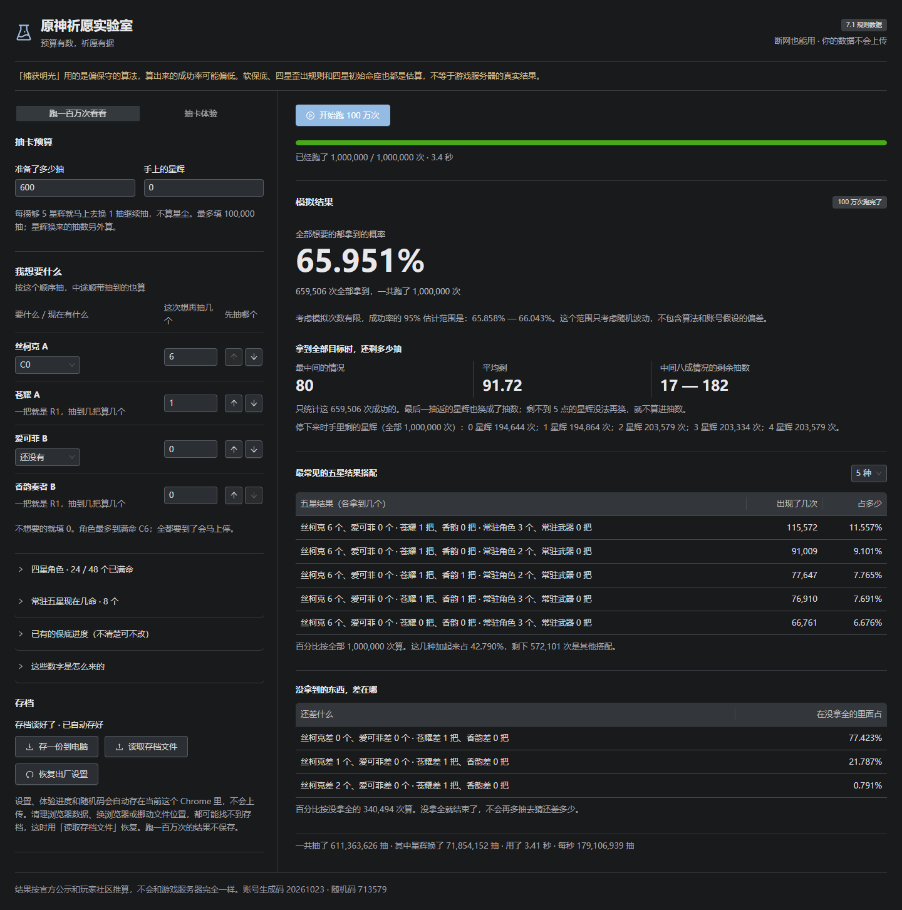
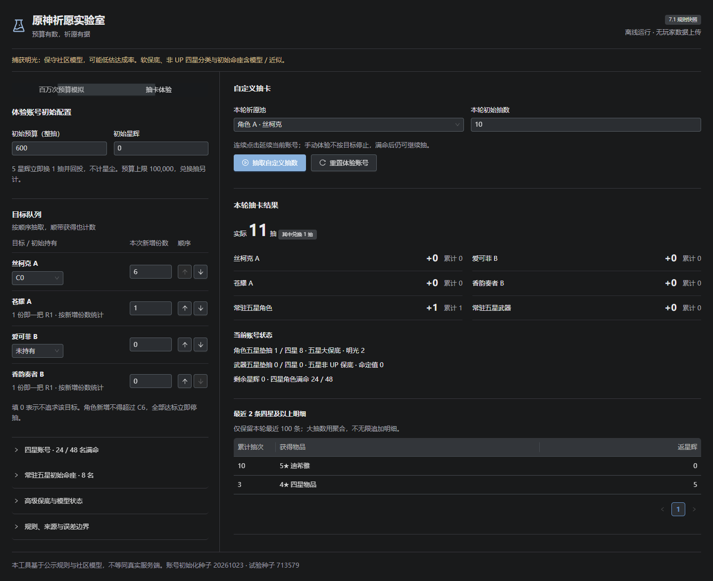
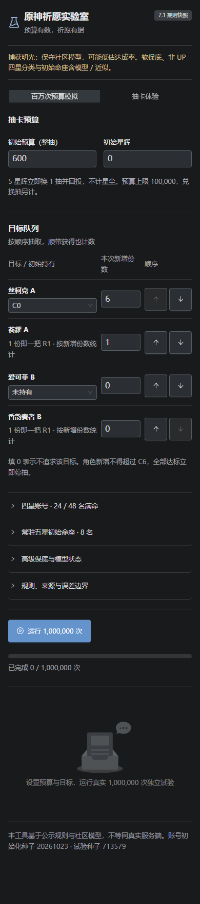

# 原神祈愿实验室

[](https://github.com/qyh9527/genshin-wish-simulator-public/releases)
[](https://qyh9527.github.io/genshin-wish-simulator-public/)
[](release/genshin抽卡模拟器.html)
[](release/genshin抽卡模拟器.html)
[](doc/rules.md)

算一下这期卡池要备多少抽。一个 HTML 文件，双击就能开，断网也能用，数据和抽卡记录都不上传。



## 怎么用

1. 在本页右边 Releases 里下 `genshin-wish-simulator.html`，或者直接去[在线试玩](https://qyh9527.github.io/genshin-wish-simulator-public/)。
2. 左边填准备了多少抽、手里多少星辉，右边挑要什么：角色写「还要再抽几个」，武器写「要几把」。填 0 就是不追这个目标。
3. 点「开始跑 100 万次」。几千抽的完整跑完大概几秒，进度条能动，跑一半想停就点取消。

跑完你会看到三块东西：

- 全部目标都拿到的概率，带一个 95% 估计范围。这个范围只反映模拟次数有限带来的随机波动，不含模型本身和账号假设的偏差。
- 成功的情况下还剩多少抽：中间情况、平均、中间八成情况的区间。
- 最常见的五星结果搭配，以及没拿全的时候差在哪一件。

星辉是边抽边换的：每满 5 星辉立刻换成 1 抽继续投进去，兑换出来的抽数单独记，不算进你填的预算。

想自己一下一下抽着玩，切到「抽卡体验」那一栏，每点一次接着上次的账号往下抽，抽到满命也不会自动停。两种模式算的是同一套规则，配置切过去还留着。

手机上是竖着排的，同样能跑百万次：

<p>


</p>

## 它算得准不准

概率参数来自官方公示：五星基础 0.6%（角色池）/ 0.7%（武器池），综合 1.6% / 1.85%，硬保底 90 / 80 抽，武器定轨 1 点，星辉兑换比例。这些是官方接口里的原文，直接读的。

下面两块官方没公开：

- **软保底曲线**（大概 74 抽以后概率往上走的那条）是玩家社区反推出来的，用的是 [OneBST/GGanalysis](https://github.com/OneBST/GGanalysis) 的固定版本源码，不是官方数据。
- **捕获明光**只公开了基础概率 0.018% 和综合 55%，完整算法从来没给过。这里用的是社区里偏保守的那一版，它通常会高估你需要准备的抽数。

另外两处属于产品近似，跟游戏机制无关：四星初始命座靠随机快照生成，常驻五星的初始持有状态由你自己填。它们只影响星辉回投多少，改一改就等于换了另一个假设账号。

所以它叫「实验室」，不叫「预测器」。一百万次能告诉你这期池子的分布长什么样，不会告诉你下个池子第几抽出货。想自己核对参数和来源，看 [规则与证据](doc/rules.md)，每条都标了来源等级。

## 自己构建

需要 Node 22 以上（Vite 8 的要求）。源码在 `src/`，构建产物直接落到 `release/`，出来就是一个完整可用的 HTML。

```bash
cd src
npm ci
npm run build      # 类型检查 + 打包 + 单文件断言
npm test           # 引擎与统计的确定性测试
npm run test:e2e   # 真浏览器开 file:// 跑一遍交互
npm run bench      # 固定参考场景跑真实一百万次，记耗时
```

改概率或角色名单之前先读 [规则与证据](doc/rules.md) 和 [产品契约](doc/product.md)，构建和离线约束在 [构建契约](doc/build.md)。开发约定见 [AGENTS.md](AGENTS.md)。

`release/` 目录里永远只有一个 HTML，构建脚本会自己检查这件事，多出别的文件就报错。

## 目录

```
src/          规则引擎、Worker 并行、界面
release/      发行文件，别的地方不用看
doc/          需求、规则依据、技术约定、验收标准
```

## 说明

非官方工具，和米哈游没有关系。角色、武器、概率文本的著作权归原厂，这里只是拿公开的祈愿公示数据做模拟。

个人存档走浏览器自己的 IndexedDB，只在你这台机器上。换浏览器、换文件路径、清浏览器数据都可能读不到旧存档，界面上有「存一份到电脑 / 读取存档文件」用来搬家。
